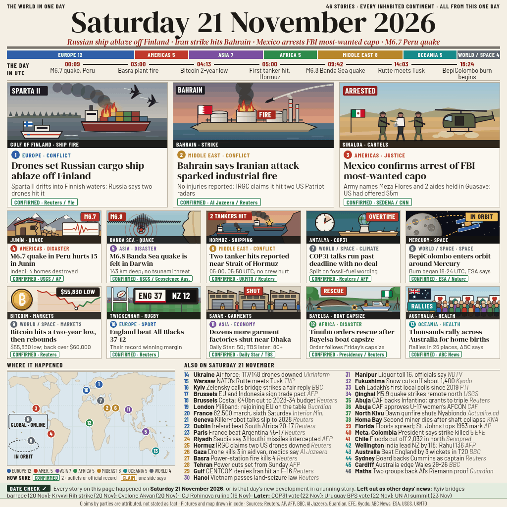

# Saturday 21 November 2026 — the world in one image

[](https://make.fun/bounty/news-image-20261121?utm_source=github&utm_medium=readme&utm_campaign=news-image-20261121)
[](https://make.fun/bounty/news-image-20261121/leaderboard?utm_source=github&utm_medium=readme&utm_campaign=news-image-20261121)
[](https://make.fun/bounty/news-image-20261121?utm_source=github&utm_medium=readme&utm_campaign=news-image-20261121)

Built with Claude Code (code) and Grok Build (research) for [make.fun](https://make.fun/r/68mq8j14).

Entry for the make.fun bounty `news-image-20261121`: sum up one day's world news in a single 1024x1024 image.



## What the image shows

- 46 stories from Saturday 21 November 2026: 13 with pictures (3 lead stories and 10 smaller cards) and 33 one-line briefs.
- 7 regions: Europe (12 stories), Middle East (8), Asia (7), Americas (5), Africa (5), Oceania (5) and World/Space (4). Each region has its own colour, and a bar under the date shows how many stories each region has.
- A map with numbered pins for the pictured stories. Space stories sit on an IN ORBIT ring, and stories with no real place (markets, online) sit in a GLOBAL · ONLINE box.
- One UTC timeline strip with 7 stops, from the M6.7 Peru quake (00:09) to the start of BepiColombo's orbit burn (18:24).
- A HOW SURE key: CONFIRMED means 2+ outlets or an official record; CLAIM means one side says it. Each picture card and brief carries one of these tags (39 confirmed, 7 claims), and each names its source. Claims by governments, armed groups or officials are attributed to them.
- A date-check band near the bottom lists 4 stories left out because they were first reported earlier (19 or 20 November) and 3 that are scheduled for later (22 and 23 November).

## Version 2

What changed from v1:

- Two new research sessions (g1, g2; `research/v2-g1.json`, `research/v2-g2.json`, notes in `research/v2-g*-notes.md`) added the Iranian strike on Bahrain, the M6.7 Peru quake, BepiColombo entering orbit around Mercury, Bitcoin's two-year low and the weekend rugby.
- A calmer layout: 3 lead stories and 10 smaller cards (v1 had 4 and 8), with bigger type. The six-key-numbers strip is gone; the UTC timeline is now the only strip.
- Items whose dates were disputed or turned out to be earlier than 21 November were dropped.
- An independent re-check (vg2, `research/verify-v2.json`) corrected the Bahrain lead to what Bahrain itself said (an industrial fire, no site named; "Sitra" was only an Iranian claim) and credited the Tehran power-cut notice to AFP.

## How it is made

1. **Research** sessions in Grok Build (r1 to r4) collected candidate stories with source links (`research/r*.json`, notes in `research/*-notes.md`). Two later gap-filling sessions (rx1, rx2) added stories for regions and beats that had too few (`research/rx1.json`, `research/rx2.json`). For v2, two more sessions (g1, g2) filled gaps and re-checked dates.
2. **Re-check** sessions in Grok Build (va, vb) checked each shortlisted story's date, figures and wording on their own (`research/verify-a.json`, `research/verify-b.json`). Stories first reported before 21 November were dropped. Figures were corrected where the sources disagreed.
3. The final content is in `data/stories.json`.
4. Code sessions in Claude Code wrote `build.py` (Python), which turns that file into an HTML/SVG page. The pictures (`illus_a.py`, `illus_b.py`) and map are drawn in code. Headless Chrome renders the page, and Pillow reduces the screenshot to a 256-colour palette PNG. The build renders twice and checks that both renders match. It also checks the file size, that no text is smaller than 11 px, and that no text overflows its box.

## How to rebuild

```sh
python3 build.py      # data/stories.json -> entry.png
python3 main.py
```

You need Python 3 with Pillow, and Google Chrome.

## Sources

Reuters, AP, AFP, BBC, Al Jazeera, Guardian, EFE, Kyodo, ABC News, ESA, USGS and UKMTO. The briefs also cite Ukrinform, TVP, the Interior Ministry, NDTV, PTI, CAF, Actualite.cd, KNA and Senapred. Each story's own source is printed on the image.

Join make.fun: https://make.fun/r/68mq8j14
